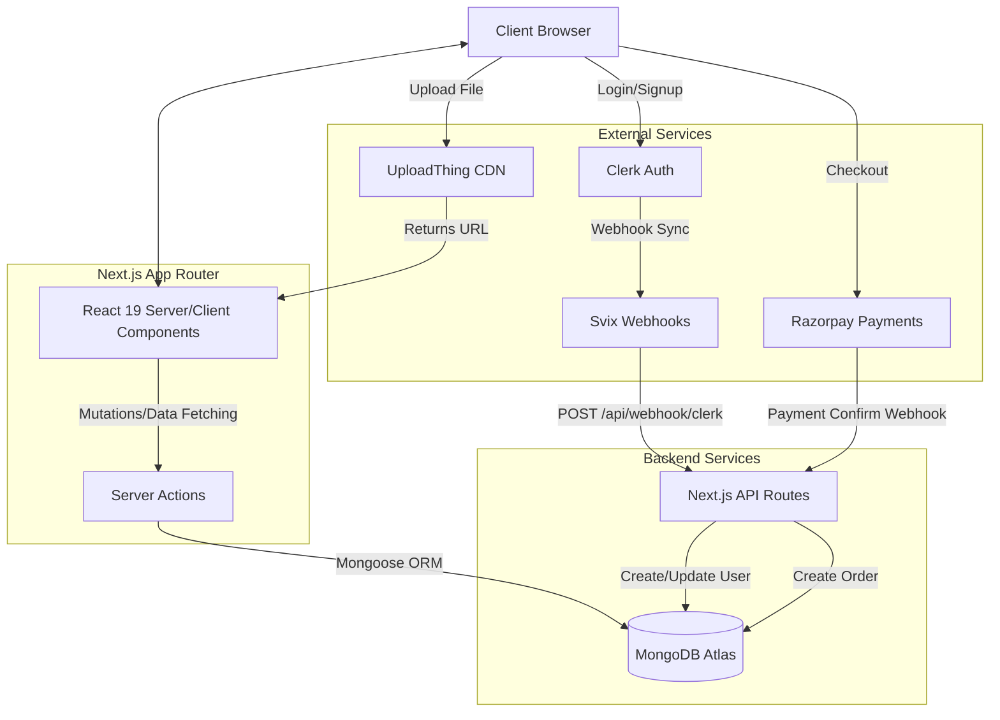
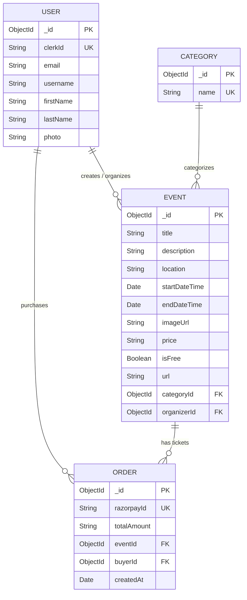

# Event Management Application 🎫

<div align="center">

**A full-stack, modern event management and ticketing platform built to handle scheduling, organization, attendee tracking, and payments seamlessly.**

[](https://nextjs.org/)
[](https://reactjs.org/)
[](https://www.mongodb.com/)
[](https://tailwindcss.com/)
[](https://opensource.org/licenses/MIT)

[Features](#-key-features) • [System Architecture](#-system-architecture) • [Database Design](#-database-design) • [Quick Start](#-quick-start)

</div>

---

## 📸 Project Media


*(Add screenshots of the Event Dashboard, Ticketing Page, and Admin interface here)*

[Watch Demo Video](assets/demo.mp4)

---

## 🎯 Key Features

✅ **Comprehensive Event Tracking** - Easily create, publish, and manage detailed events with dates, locations, and capacities.  
✅ **Secure Authentication** - Integrated **Clerk Auth** for a robust, secure, and customizable login experience.  
✅ **Ticketing & Payments** - Built-in **Razorpay** integration to handle secure ticket purchases and transactions.  
✅ **Media Management** - Seamless integration with **Uploadthing** for uploading and hosting high-quality event banners and media.  
✅ **Webhook Syncing** - Utilizes **Svix** for robust webhook handling (syncing Clerk users with the database).  
✅ **Modern UI/UX** - Clean, accessible, and responsive interface powered by **Tailwind CSS** and **Shadcn/UI** components.  
✅ **Dark Mode Support** - Full dark/light mode functionality using `next-themes`.

---

## 🏗 System Architecture

The application is built on modern React Server Components (RSC) using the **Next.js 15 App Router**. It employs a Serverless architecture, leveraging third-party APIs to handle heavy lifting (Auth, Payments, Media) while keeping the core server logic minimal.



### Server Actions Architecture
Instead of traditional REST APIs, the application heavily uses **Next.js Server Actions** (`lib/actions/*`) for database operations. This provides end-to-end type safety and significantly reduces client-side JavaScript.

- `user.actions.ts`: Handles User creation, updating, and deletion (triggered via Clerk Webhooks).
- `event.actions.ts`: Handles Event creation, retrieval, updating, and deletion.
- `category.actions.ts`: Manages dynamic event categories.
- `orders.action.ts`: Handles ticket purchasing logic and order history tracking.

---

## 🗄 Database Design

The data layer uses **MongoDB** connected via **Mongoose**. Below is the Entity-Relationship overview:



---

## 🚀 Quick Start

### Prerequisites
- **Node.js** (v18 or higher)
- **MongoDB** (Local or Atlas Cluster)
- **Clerk Account** (For Authentication)
- **Uploadthing Account** (For Media)
- **Razorpay Account** (For Payments)

### 1. Clone & Install
```bash
git clone https://github.com/Sameer-Bagul/event-management-application.git
cd event-management-application

npm install
```

### 2. Configure Environment
Create a `.env.local` file in the root directory:
```bash
cp .env.example .env.local
```
*(Populate with your API keys. See [Configuration](#-configuration) below).*

### 3. Start Development Server
```bash
npm run dev
```
*The application will be available at `http://localhost:3000`.*

---

## 🔧 Configuration (.env.local)

```env
# NEXT.JS CONFIG
NEXT_PUBLIC_SERVER_URL=http://localhost:3000

# MONGODB CONFIG
MONGODB_URI=mongodb+srv://<username>:<password>@cluster.mongodb.net/eventsDB

# CLERK AUTH
NEXT_PUBLIC_CLERK_PUBLISHABLE_KEY=pk_test_...
CLERK_SECRET_KEY=sk_test_...
WEBHOOK_SECRET=whsec_...

NEXT_PUBLIC_CLERK_SIGN_IN_URL=/sign-in
NEXT_PUBLIC_CLERK_SIGN_UP_URL=/sign-up

# UPLOADTHING (Media)
UPLOADTHING_SECRET=sk_live_...
UPLOADTHING_APP_ID=...

# RAZORPAY (Payments)
NEXT_PUBLIC_RAZORPAY_KEY_ID=rzp_test_...
RAZORPAY_KEY_SECRET=...
```

---

## 🤝 Contributing

Contributions are always welcome!
1. Fork the repository
2. Create your feature branch (`git checkout -b feature/NewFeature`)
3. Commit your changes (`git commit -m 'Add some NewFeature'`)
4. Push to the branch (`git push origin feature/NewFeature`)
5. Open a Pull Request

---

## 📝 License & Contact

This project is licensed under the MIT License.

**Author**: Sameer Bagul  
**GitHub**: [github.com/Sameer-Bagul](https://github.com/Sameer-Bagul)
